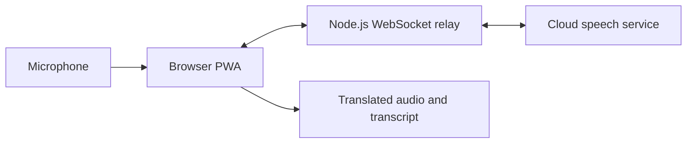

# Live Translate

**Speak in one language. Hear the translation. Keep the words.**

Live Translate is a working AI application for live spoken translation and transcription. It runs in a browser, fits a phone screen, and can be installed as a Progressive Web App.

I built it to explore what makes speech AI useful in an actual conversation: a simple interface, streamed responses, clear listening controls, and predictable behavior when audio or connectivity is interrupted.

## See it in action

TODO add video

## What it does today

- **Live translation:** streams microphone audio and returns translated speech alongside a readable transcript, with 29 spoken target languages.
- **Speech to text:** captures the original words in their original language, with automatic source-language detection.
- **Simple session controls:** choose a language, start a mode, and tap again to stop. Only one mode can run at a time.
- **Useful transcripts:** selectable, copyable text, including final recognition corrections.
- **Installable interface:** responsive layouts for phones and desktops, plus a cached application shell that opens offline. Translation requires an internet connection.
- **Controlled access:** users enter a service access token; the speech provider's API credential stays on the server.

The app is designed for foreground use with the screen unlocked. Headphones help prevent translated speech from feeding back into the microphone.

## Behind the interface

| Area | Implementation |
| --- | --- |
| Frontend | HTML, CSS and JavaScript modules, without a frontend build step |
| Audio capture | Web Audio and AudioWorklet, with streaming conversion to mono 16 kHz PCM |
| Transport | WebSockets carrying audio chunks and incremental text events |
| Playback | Scheduled 24 kHz PCM audio with bounded buffering |
| Backend | Node.js relay with token validation, origin checks, timeouts and credential isolation |
| PWA and deployment | Web app manifest, service worker, Docker and Compose configuration |
| Validation | Node tests, Playwright coverage in Chromium and mobile-sized WebKit, and live-service benchmarks |

The engineering work includes releasing microphone access on cancellation, handling interrupted sessions, reconciling partial transcripts, and preserving final text when a session ends. The relay does not persist audio or transcripts; cloud processing follows the speech service's data policies.

Latency is measured at several points, including first response and the delay at the end of a passage. These are different experiences: translated speech can start promptly while later audio accumulates in the playback queue. Browser tests and synthetic benchmarks complement physical-device testing.

## What's next

- [ ] **OIDC integration with Keycloak:** replace the shared service access token with user sign-in.

## Feedback and issues

Curious about the implementation, or found something that could work better? Open an issue in this repository.

For a bug report, please include:

- Device, operating system and browser version; browser tab or installed PWA.
- Mode, source language and target language.
- Steps to reproduce, expected behavior and what happened instead.
- Relevant details such as headphones, network changes or an interrupted session.

Please leave out access tokens, API credentials and private conversation recordings. A short, non-sensitive example is usually enough to start investigating.
